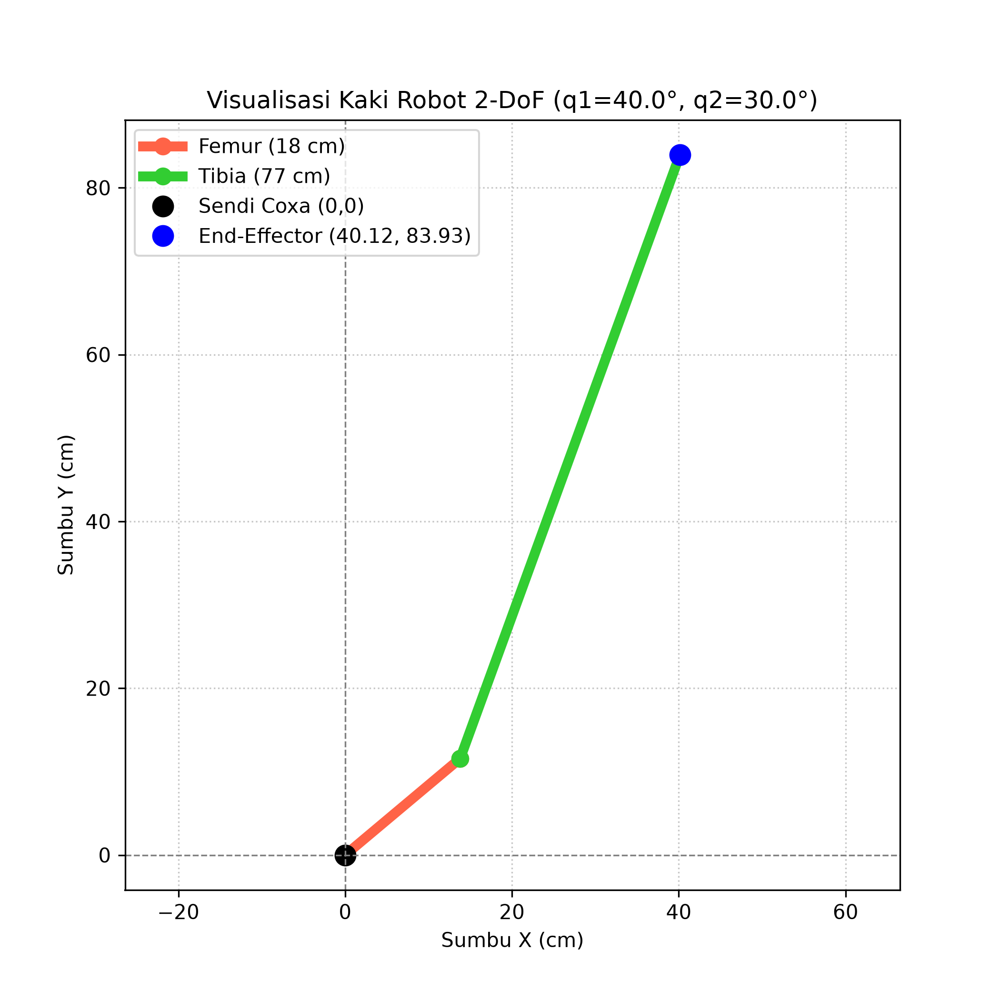
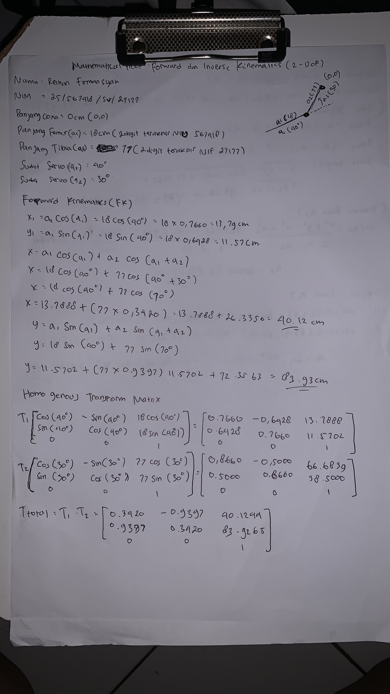
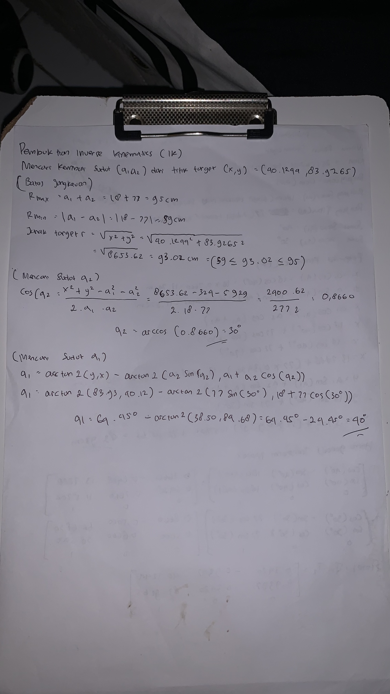

# Forward & Inverse Kinematics 2-DoF Robot Leg — Magang GMRT

## Profil
* **Nama:** Reihan Firmansyah
* **NIM:** 25/567418/SV/27177

## Deskripsi Singkat
Program ini merupakan simulasi perhitungan kinematika kaki robot planar **2 Degree of Freedom (2-DoF)** menggunakan bahasa pemrograman Python. Studi kasus ini memodelkan struktur kaki robot yang terdiri dari sendi pangkal **Coxa** di titik pusat `(0, 0)`, segmen **Femur**, dan segmen **Tibia**.

Berdasarkan identitas NIM (2 digit terakhir NIU `567418` dan NIF `27177`), parameter panjang segmen kaki yang digunakan adalah:
* **Panjang Coxa:** `0 cm`
* **Panjang Femur (a1):** `18 cm`
* **Panjang Tibia (a2):** `77 cm`

Program ini menghitung posisi titik akhir ujung kaki (*end-effector*) menggunakan **Homogeneous Transformation Matrix** (`NumPy`), dilengkapi fitur pencarian sudut servo melalui **Inverse Kinematics (IK)** beserta deteksi batas jangkauan (*workspace*), serta menampilkan visualisasi postur kaki robot secara grafis menggunakan `Matplotlib`.

## Fitur yang Diimplementasikan

| No | Kategori | Fitur | Status |
| :--- | :--- | :--- | :---: |
| 1 | **Fitur Wajib** | Perhitungan Forward Kinematics (FK) 2-DoF Interaktif (`input()`) | ✅ |
| 2 | **Fitur Wajib** | Pengujian *Test Case* (q1 = 40°, q2 = 30°) menghasilkan `(40.12, 83.93)` | ✅ |
| 3 | **Fitur Bonus** | *Mathematical Proof* (Lampiran Perhitungan Tulis Tangan FK & IK) | ✅ |
| 4 | **Fitur Bonus** | *Homogeneous Transformation Matrix* menggunakan `NumPy` | ✅ |
| 5 | **Fitur Bonus** | Visualisasi Postur Kaki Robot menggunakan `Matplotlib` (`.png` & *Pop-up*) | ✅ |
| 6 | **Fitur Bonus** | *Inverse Kinematics (IK)* beserta peringatan *Out of Workspace* | ✅ |

## Cara Instalasi & Menjalankan Program

1. **Clone repositori ini:**
   `git clone https://github.com/reihanfirmansyah/25-567418-SV-27177_ReihanFirmansyah_MagangGMRT.git`
   `cd 25-567418-SV-27177_ReihanFirmansyah_MagangGMRT`

2. **Instal library yang dibutuhkan (`numpy` dan `matplotlib`):**
   `pip install -r requirements.txt`

3. **Jalankan program:**
   `python main.py`

## Hasil Pengujian (Test Case)
* **Input:** Sudut Servo 1 (q1) = `40°`, Sudut Servo 2 (q2) = `30°`
* **Output Koordinat Sendi Lutut:** `(13.79, 11.57) cm`
* **Output Koordinat End-Effector:** `(40.12, 83.93) cm`

## Mathematical Proof (Perhitungan Tulis Tangan)

